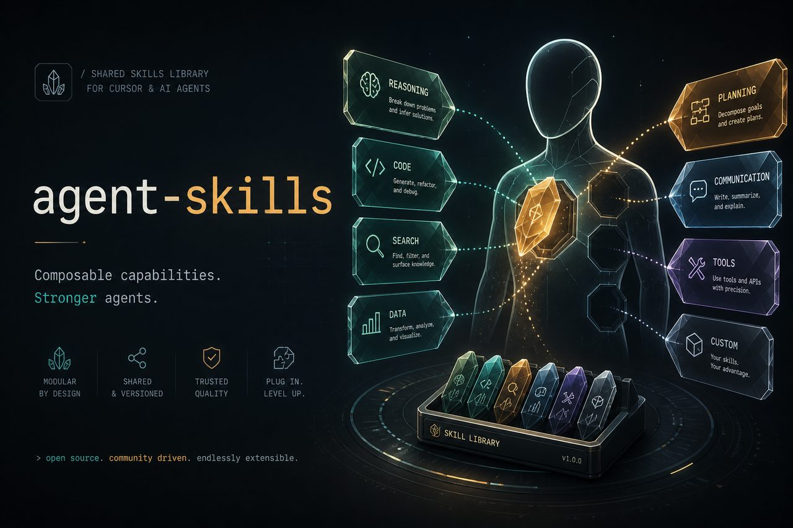

# DataKnifeAI agent skills




Shared [Cursor agent skills](https://cursor.com/docs/context/skills) and **shared Cursor rules** for DataKnifeAI repositories.

## Layout

```text
skills/
  <skill-name>/
    SKILL.md
    scripts/          # optional
rules/
  dataknifeai-common.mdc
  templates/          # project override examples
```

## Adding a skill

1. Create `skills/<skill-name>/SKILL.md` with YAML frontmatter (`name`, `description`) and clear instructions.
2. Open a PR; keep scope to one new skill or one focused change per PR when possible.

## Shared rules

Org-wide agent defaults live in [`rules/dataknifeai-common.mdc`](rules/dataknifeai-common.mdc). **Vendor a copy** into each product repo at `.cursor/rules/dataknifeai-common.mdc` and commit it; add thin project overrides beside it. Normal clones then pick up the rules with no install step — see [`rules/README.md`](rules/README.md).

To refresh a vendored copy from this canonical source (optional; also useful for agent-workspace):

```bash
make install-rules-copy
./scripts/install-rules.sh --copy
```

## Install skills (Cursor / Coder workspaces)

Cursor loads **project** skills from `.cursor/skills/<skill-name>/` in the workspace (or **user** skills from `~/.cursor/skills/`).

### Makefile

From a checkout of this repository:

```bash
make help                 # list targets (default)
make install              # ./.cursor/skills (symlinks)
make install-user
make install-rules-copy   # refresh vendored .mdc into ./.cursor/rules
make dry-run
make list                 # skill directory names
make list-rules
make validate             # skills + rules
make clone-install        # optional: CLONE_URL=… CACHE=…
make clean-project        # rm -rf ./.cursor/skills
```

Subset: `make install ONLY=gh-cli,kubectl-cli`.

### Installer script

From a checkout of this repository:

```bash
./scripts/install-skills.sh              # ./.cursor/skills (symlinks)
./scripts/install-skills.sh --user       # ~/.cursor/skills
./scripts/install-skills.sh --only gh-cli,kubectl-cli
./scripts/install-skills.sh --copy       # copy trees instead of symlinks
./scripts/install-rules.sh --copy        # refresh vendored rules into ./.cursor/rules
```

Bootstrap skills from GitHub without cloning the full repo yourself (shallow clone to the cache, then symlink into `./.cursor/skills`):

```bash
bash -c 'curl -fsSL https://raw.githubusercontent.com/DataKnifeAI/agent-skills/main/scripts/install-skills.sh | bash -s -- --clone https://github.com/DataKnifeAI/agent-skills.git'
```

The rules installer supports the same `--clone` pattern when refreshing a vendored copy from a remote source. Use `--clone` with an internal mirror URL if your deployment mirrors this repo. Override the cache directory with `--cache DIR`. Run `./scripts/install-skills.sh --help` or `./scripts/install-rules.sh --help` for all options.

### Manual install

If you prefer not to use the script: clone or submodule this repo, then symlink each `skills/<name>/` directory into `.cursor/skills/<name>/`, or install under `~/.cursor/skills/`. For rules, copy `rules/dataknifeai-common.mdc` into the product repo’s `.cursor/rules/` and commit it.

Ensure `glab`, `gh`, `coder`, `kubectl`, and/or `rancher` are on `PATH` in the workspace image when those skills apply; the skills document CLI usage only.

## License

This repository is licensed under the Apache License 2.0 — see [LICENSE](LICENSE).
